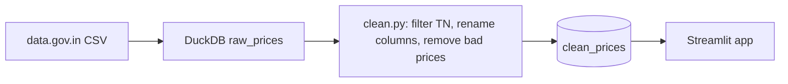

# Tamil Nadu Mandi Price Intelligence

A Streamlit app that compares daily vegetable and commodity prices across
Tamil Nadu mandis and shows where it is cheapest to buy.

## Problem
Prices for the same commodity differ a lot between markets on the same day.
Buyers need a quick way to see the cheapest and dearest markets.

## What it does
- Pick a commodity and (optionally) districts
- See the best market to buy from, with the potential saving
- Compare the cheapest vs dearest markets, district averages and a price table
- Download the filtered data as CSV

## Data
Agmarknet daily mandi prices via data.gov.in. Prices are reported in Rs/quintal
and converted to Rs/kg (divided by 100).

## Architecture


## Project structure
```
app.py            Streamlit app
src/load_data.py  Load raw CSV into DuckDB
src/clean.py      Build clean_prices table
src/profile_data.py, check_dates.py, stats.py   Data checks
sql/analysis.sql  Analysis queries
data/raw/         Source CSV
```

## Run it
```
pip install -r requirements.txt
python src/load_data.py
python src/clean.py
streamlit run app.py
```

## Key findings
Run `python src/stats.py` and add the numbers here
(rows cleaned, markets covered, price gap per commodity).

## Limitations
- Data covers a single day, so there is no trend or forecast yet
- Prices are modal prices as reported by each market
- Market reporting varies; missing markets are not imputed

## Roadmap
- Daily automated data collection to build history
- 7-day forecast with backtesting against a naive baseline
- Buy / Hold / Sell recommendation
- dbt models, data tests, Docker, deployment
